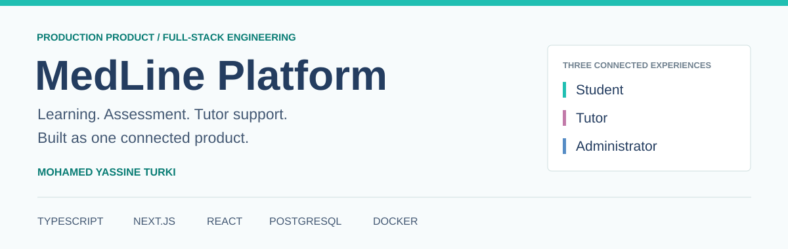
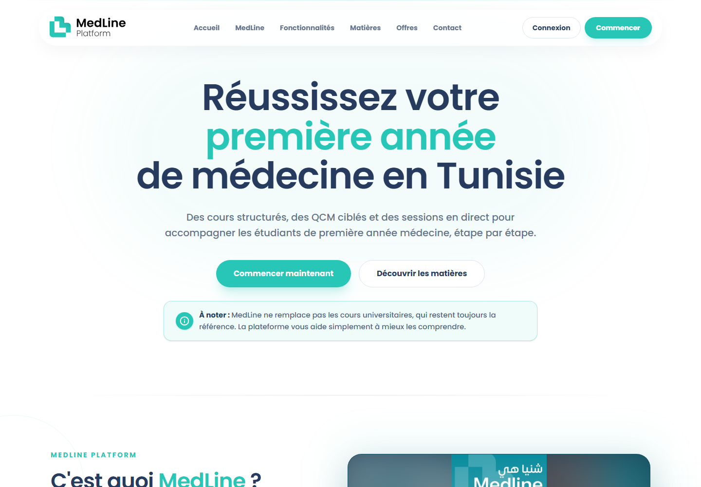

  <a href="https://medlineplatform.com">Live platform</a> &nbsp; / &nbsp;
  <a href="docs/product-tour.md">Product tour</a> &nbsp; / &nbsp;
  <a href="docs/engineering-case-study.md">Engineering case study</a> &nbsp; / &nbsp;
  <a href="docs/architecture.md">Architecture</a> &nbsp; / &nbsp;
  <a href="docs/recruiter-brief.md">Recruiter brief</a>

# MedLine Platform

**A production medical education platform connecting structured learning, assessment, tutor support, and subscription operations.**

Developed by [Mohamed Yassine Turki](https://github.com/MohamedYassineTurki), ICT engineer at INSAT. MedLine serves first-year medical students in Tunisia through a French-language experience spanning video courses, corrected multiple-choice questions, live sessions, recordings, learning documents, and tutor interaction.

This repository is the public engineering showcase. The production application and its source repository remain private.

| Product experiences | Application engineering | Operational delivery |
| --- | --- | --- |
| **Student / Tutor / Administrator** | **TypeScript, Next.js, React, PostgreSQL** | **Docker, schema migrations, deployment workflows** |

## Why this is more than a course website

MedLine joins the learning journey to the workflows required to operate it. A student discovers a subject, activates access, studies a lesson, practices QCMs, revisits a recording, and asks a tutor for help. Administrators manage the catalog, subscription plans, payment requests, live events, communications, and learning activity through a dedicated workspace.

The engineering work crosses interface design, server-side business logic, relational data modeling, external service integration, reporting, automated testing, and containerized delivery.

## Product at a glance

*Actual public homepage capture. More visuals and their provenance are in the [product tour](docs/product-tour.md).*

| Capability | User value | Engineering represented |
| --- | --- | --- |
| Structured course library | Move from a subject to ordered courses, lessons, and documents | Relational content hierarchy, publication controls, ordered navigation |
| Corrected QCM practice | Select answers, check corrections, and navigate questions | Assessment state, multiple-correct-answer handling, validated spreadsheet import |
| Live learning and replays | Attend a session and study its recording later | Event lifecycle, multi-part recordings, duration reconciliation |
| Tutor interaction | Ask subject-specific questions and receive follow-up | Role-aware conversations, announcements, attachments, unread state |
| Wallet and subscriptions | Activate subject or all-access learning plans | Payment-review workflow, transactional balance changes, subscription lifecycle |
| Progress and engagement | Continue studying with a clear view of activity | Completion tracking, engagement aggregation, date-aware reporting |
| Administration | Operate content, users, payments, and learning activity | Dedicated management interfaces, filters, charts, and business workflows |

## Technical stack

| Area | Technologies |
| --- | --- |
| Application | TypeScript, Next.js App Router, React, Server Components, Server Actions |
| Interface | Tailwind CSS, Lucide, Recharts, responsive navigation |
| Data | PostgreSQL, Drizzle ORM, versioned SQL migrations, Zod validation |
| Identity | Better Auth, role-aware application experiences |
| Content | Bunny video integration, PDF.js, server-side document processing |
| Communications | Transactional email, scheduled notifications, tutor follow-up |
| Operations | Docker, Docker Compose, Dokploy-oriented deployment configuration |
| Quality | Node.js test runner, tsx, Playwright browser/integration scenarios |

Provider names describe integrations, not technologies built from scratch. Live meetings use an external meeting service; MedLine manages the scheduling, access experience, and replay organization around it.

## Selected engineering stories

### 1. Connect content, assessment, and continuity

Course study combines ordered lessons, supporting documents, corrected questions, and progress. Replay collections reuse the learning model while supporting multiple video parts. This makes content organization a coherent application domain rather than a group of unrelated pages.

### 2. Make business state consistent

The subscription workflow connects a student's balance, selected plan, access period, and transaction history. Server-side validation and database transactions coordinate those changes. Local payment-review workflows are represented explicitly rather than presented as an automated card-processing integration.

### 3. Separate user roles without fragmenting the product

Students, tutors, and administrators have different tasks and interfaces. The codebase uses role-specific application areas with shared services and reusable UI, keeping the experience consistent while supporting distinct responsibilities.

### 4. Turn activity into useful reporting

The analytics implementation distinguishes visits, active learning, content context, and reporting periods. It handles local calendar boundaries and cross-tab activity coordination so operational reporting has a more meaningful basis than raw page views.

Read the [case study](docs/engineering-case-study.md) for implementation reasoning and the [architecture overview](docs/architecture.md) for the system's major responsibilities.

## Evidence of engineering depth

The reviewed source snapshot contains **22 focused TypeScript test modules** and **42 SQL migration files**. These are repository evidence, not user-adoption or performance metrics. The [quality overview](docs/quality.md) explains the verification scope and test categories.

The live public site advertises a catalog of **500+ educational videos**, **300+ corrected QCMs**, **10+ tutors**, and **10+ subjects**. These are public product figures, not independently measured counts of active users or commercial results. [Source and date](docs/evidence.md).

## Explore this showcase

| For | Start here |
| --- | --- |
| Recruiters and hiring teams | [One-page project brief](docs/recruiter-brief.md) |
| Engineering interviewers | [Engineering case study](docs/engineering-case-study.md) |
| Technical reviewers | [Conceptual architecture](docs/architecture.md) and [quality practices](docs/quality.md) |
| Product and design reviewers | [Product tour and screenshots](docs/product-tour.md) |
| Automated project readers | [Structured project summary](project-summary.json) |

## About the public materials

This is a documentation and visual showcase, not an installable distribution of the production application. Screenshots come from public pages; the public feature previews are identified as illustrations. No production source, database exports, private dashboards, customer conversations, or operational credentials are distributed here. Architecture is presented at a conceptual level.

**Live product:** [medlineplatform.com](https://medlineplatform.com)

**Developer:** [Mohamed Yassine Turki](https://github.com/MohamedYassineTurki)

**Review snapshot:** 7 November 2026
