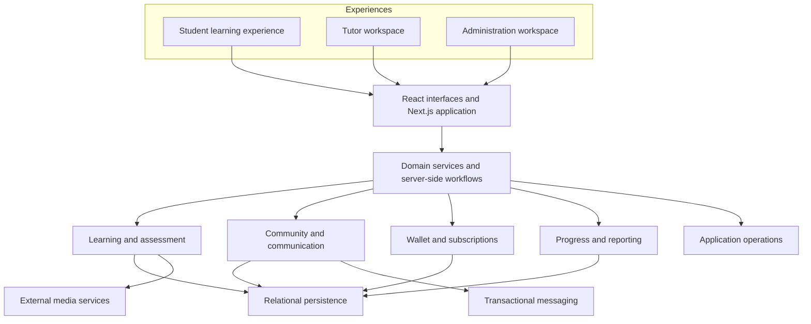
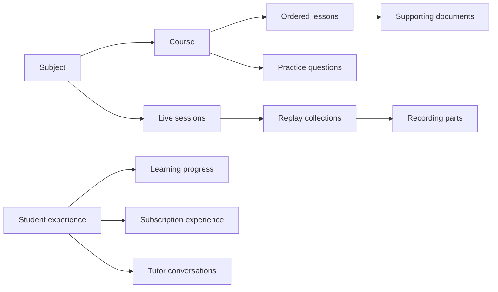

# Conceptual architecture

MedLine is a full-stack Next.js application organized into domain modules. It is presented here as a modular application, not as a microservices system.

This diagram shows logical responsibilities, not production network topology, hostnames, endpoint inventories, or security configuration.

## Application responsibilities

| Layer | Responsibility | Representative technologies |
| --- | --- | --- |
| Experience | Role-specific navigation, learning screens, forms, charts, and responsive layouts | React, Tailwind CSS, Lucide, Recharts |
| Application | Rendering, user workflows, requests, and server-side mutations | Next.js App Router, Server Components, Server Actions |
| Domain | Content organization, assessment, subscriptions, community, reporting | TypeScript, Zod |
| Persistence | Related business records, transactions, schema evolution | PostgreSQL, Drizzle ORM, SQL migrations |
| Integrations | Video delivery, document processing, transactional messages | Media provider, PDF.js, email provider |
| Delivery | Packaged application builds and environment-specific runtime configuration | Docker, Docker Compose, Dokploy-oriented configuration |

## Domain model at a public level

These are product concepts rather than a database schema. The production schema, identifiers, storage layout, and access-policy implementation are not distributed here.

## Key architectural choices

**A shared application with domain boundaries.** Student, tutor, and administrator workflows share common infrastructure and reusable services. This keeps connected product behavior in one deployable application while separating responsibilities in the codebase.

**Relational persistence for business state.** Content, subscriptions, transactions, and learning activity have meaningful relationships. PostgreSQL and Drizzle support those relationships, transactional updates, and incremental schema evolution.

**External media delivery.** The platform integrates a specialist provider for video delivery while keeping catalog organization, the learning interface, documents, and related workflows in the application.

**Background communication.** Follow-up messages are handled through explicit delivery workflows, separately from the interactive learning experience.

**Domain-aware reporting.** Reporting considers learning context and local calendar periods instead of treating every page interaction as equivalent.

The public showcase makes no claim about audited security, regulatory certification, production load capacity, or uptime guarantees.
