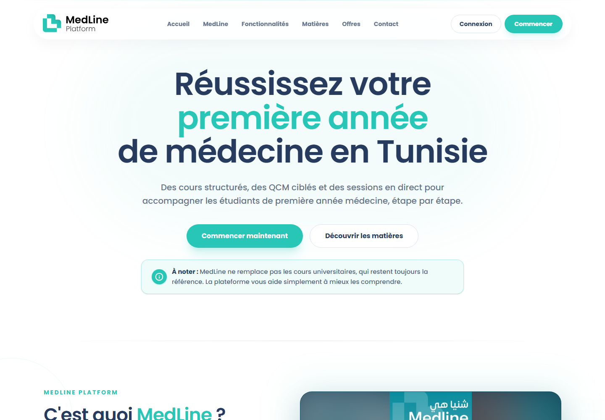
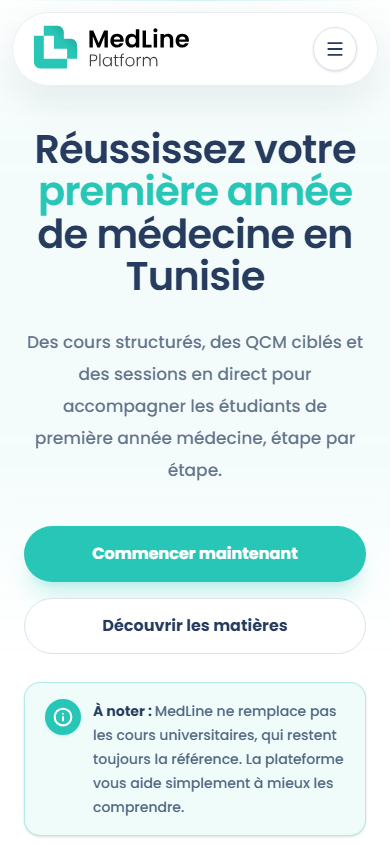
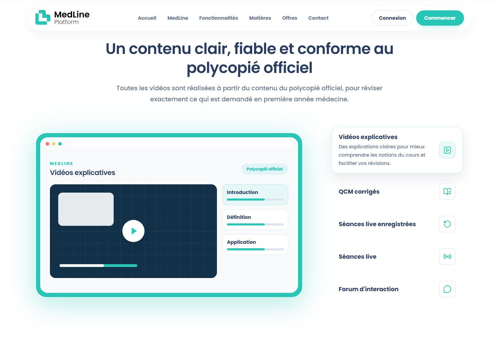
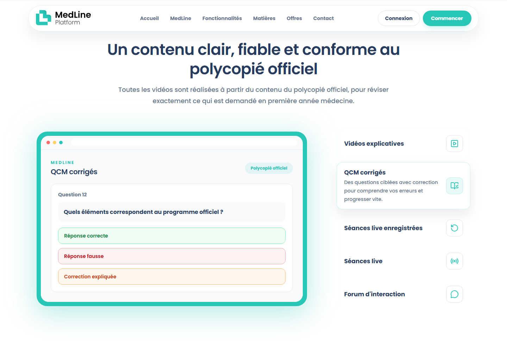

# Product tour

MedLine is designed around first-year medical study in Tunisia. The public interface is French-language and connects learning content, practice, live teaching, and support.

## Public product entry

The public entry page introduces the learning formats, subject catalog, and subscription options. This capture shows the live public product, not a newly designed portfolio mockup.

## Learning experience preview

This is the **public site's illustrative feature preview**, not an authenticated student dashboard capture. It communicates the course-viewing experience without exposing a student's account or paid course content.

## QCM experience preview

This is also a **public-site illustration**. The corresponding private implementation supports multiple-choice selection, correction feedback, explanatory content, and question navigation.

## Three connected journeys

| Journey | Product experience |
| --- | --- |
| Student | Discover subjects, activate access, study lessons and documents, practice QCMs, attend live sessions, review recordings, track progress, and ask for help |
| Tutor | Participate in assigned subject spaces, respond to student questions, and communicate through conversations and announcements |
| Administrator | Manage content, publish learning material, operate live sessions, review payments, manage subscriptions, and inspect learning activity |

## Visual provenance

Captured from https://medlineplatform.com on **7 November 2026** at desktop and mobile viewports. Only public pages and public feature-preview controls were used. No production account was authenticated, no private record was opened, and no user or administration dashboard is shown. The logo is a brand asset already served by the public product.
